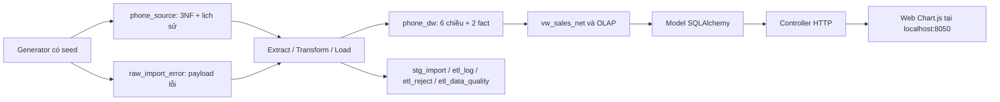
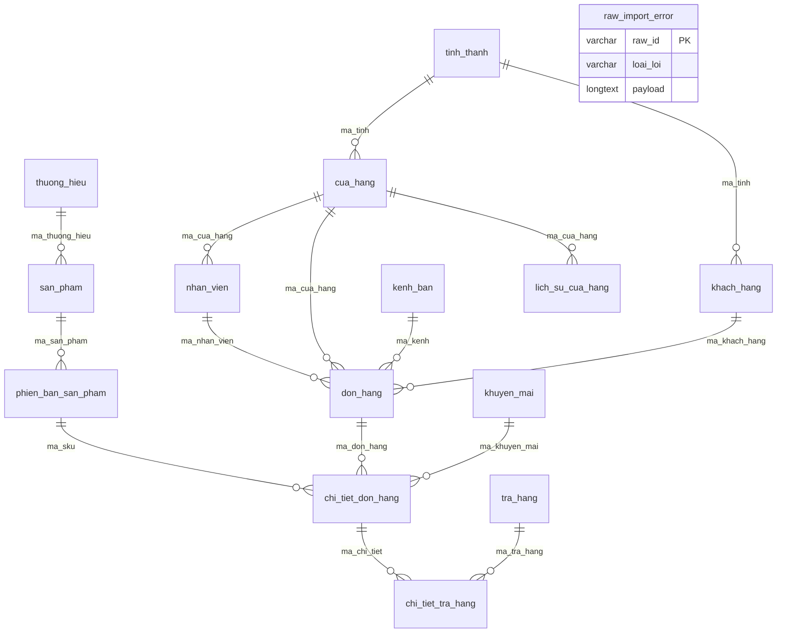
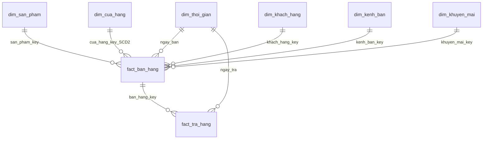

# Kiến trúc kho dữ liệu bán điện thoại

## Luồng hệ thống



Generator tạo dữ liệu mô phỏng có quy luật mùa vụ, kênh, thương hiệu và khuyến mại; các quy luật sinh dữ liệu không phải phát hiện thị trường. Lỗi nhập thô được lưu riêng, không tắt khóa ngoại để chèn lỗi vào các bảng nghiệp vụ.

## ERD nguồn

13 bảng nghiệp vụ gồm: thương hiệu, sản phẩm, phiên bản, tỉnh thành, cửa hàng, khách hàng, kênh, khuyến mại, nhân viên, đơn hàng, chi tiết đơn, trả hàng, chi tiết trả. Hai bảng hỗ trợ là `lich_su_cua_hang` và `raw_import_error`; tổng cộng 15 bảng nguồn.



`raw_import_error` độc lập về FK vì phải giữ cả tham chiếu không tồn tại. `payload` là JSON hợp lệ về cú pháp nhưng có thể sai nghiệp vụ. Nguồn 3NF tách nhãn thương hiệu, địa lý, SKU và đầu đơn khỏi dòng giao dịch; một đơn có nhiều SKU và một dòng bán có thể có nhiều lần trả.

## Star schema



Grain bán: **một dòng chi tiết đơn hợp lệ**, duy nhất `ma_chi_tiet`; `ma_don_hang` là chiều suy biến, không phải grain. Grain trả: **một dòng chi tiết trả**, duy nhất `ma_chi_tiet_tra`. Fact trả lấy sản phẩm, cửa hàng, khách, kênh, khuyến mại qua fact bán gốc; thời gian trả và bán cùng dùng dimension lịch nhưng có vai trò khác.

`vw_sales_net` cộng các lần trả theo `ban_hang_key` trước khi LEFT JOIN với fact bán. Nhờ đó mỗi dòng bán xuất hiện đúng một lần; bán chưa trả có các khoản trả bằng 0. JOIN trực tiếp hai fact rồi SUM doanh thu sẽ nhân doanh thu nếu có nhiều lượt trả.

## SCD2 và tính nhất quán

Cửa hàng thay đổi `khu_vuc_quan_ly`; giữ mỗi phiên bản với khóa thay thế riêng. Khoảng ngày là `[ngay_hieu_luc, ngay_het_han)`. Ví dụ đổi ngày 2025-07-01: phiên bản cũ hết hạn **2025-07-01**, phiên bản mới bắt đầu **2025-07-01**; không trừ một ngày. Lookup:

```sql
ngay_ban >= ngay_hieu_luc AND ngay_ban < ngay_het_han
```

Mỗi mã cửa hàng có đúng một phiên bản current; các khoảng không chồng lấn. Ngày bán trước thay đổi giữ khu vực cũ, ngày đúng mốc thuộc khu vực mới. Ngày trả không làm đổi cửa hàng lịch sử của dòng bán. Chạy lại cùng thay đổi không được tạo phiên bản trùng.

ETL và thay đổi SCD cần tuần tự hóa qua khóa chung; phần DML nạp kho phải dùng transaction và rollback khi lỗi. Khởi tạo DDL trong MariaDB/MySQL có thể implicit commit nên không coi việc tạo schema và toàn bộ ETL là một transaction duy nhất. Theo dõi `run_id`, trạng thái lỗi và số lượng; không hiển thị thành công khi pipeline ném lỗi. Chi tiết triển khai thực tế xem `etl/pipeline.py` và `etl/demo_scd2.py`.

## Web và giới hạn

Model chứa SQL/nghiệp vụ; Controller kiểm tra tham số, điều phối và trả lỗi; View hiển thị KPI, sáu biểu đồ, lịch sử SCD2, ETL/kiểm thử và SQL. Chart.js dùng tài nguyên local. Dashboard cần server và database; mở HTML trực tiếp không tạo dữ liệu thật.

SQL playground chỉ dành cho SELECT được cho phép, có giới hạn thời gian và số dòng, không truy cập database khác. Các bộ lọc phải áp dụng đồng nhất cho mọi KPI và biểu đồ; khi thao tác nhanh, chỉ phản hồi tương ứng bộ lọc mới nhất được hiển thị. Đây là ứng dụng demo cục bộ; không coi server HTTP tích hợp là nền tảng triển khai công khai.

## Chi tiết triển khai ETL hiện hành

`etl/pipeline.py` lấy named lock `phone_dw_pipeline` trước DML và dùng `conn.begin()` để nạp dimension, SCD2, fact, staging và audit. Cùng khóa được `etl/demo_scd2.py` sử dụng. Khi lỗi, transaction DML rollback và thêm log `FAILED` riêng; khi thành công xuất `etl_log_latest.json`, `etl_data_quality_latest.json`, `etl_reject_latest.json` vào `output/phone_sales/`.

Dòng đơn hủy được ghi reject `cancelled_order`; lượt trả thiếu bán, trước ngày bán hoặc vượt giới hạn bị loại với lý do cụ thể. Lượt trả đã nạp nhưng nay không còn hợp lệ được gỡ trong transaction. Nguồn nhập lỗi thô được kiểm tra và ghi reject, không nạp thành giao dịch thật. Staging giữ envelope của dòng bán, trả và lỗi thô theo run_id; đây là vùng audit, không phải chỉ các dòng đã làm sạch.

Đổi sang khu vực khác tại ngày hiệu lực đã tồn tại bị từ chối để bảo toàn lịch sử; chọn ngày mới. Không ghi đè phiên bản tại cùng mốc. Thay đổi hồi tố sẽ tra lại khóa fact thuộc cửa hàng theo đúng lịch sử mới; bán trước mốc giữ phiên bản trước mốc. Gọi lại cùng khu vực tại mốc không đổi trả `changed=False`.


## Danh mục và dữ liệu được giữ khi nâng cấp

Generator hiện sinh 16 chương trình: `NONE` và 5 nhóm mùa vụ cho mỗi năm 2024, 2025, 2026 (Tết, hè, ngày đôi, cuối năm, khách hàng thân thiết). Ngày bắt đầu/kết thúc được kiểm tra trong transform theo ngày bán. Danh mục trên database đang nâng cấp giữ thêm 4 mã cũ không còn được giao dịch tham chiếu, nên có thể thấy 20 dòng khuyến mại; không xóa các dòng này chỉ để ép số đếm thành 16. Chiều khuyến mại vẫn là một trong sáu dimension.

Nguồn bổ sung `nhan_vien`: cửa hàng → nhân viên → đơn hàng; `don_hang` đồng thời giữ FK cửa hàng để kiểm tra nhân viên đúng điểm bán. Kho hiện không có dimension nhân viên, nên không tuyên bố dashboard đã hỗ trợ phân tích hiệu suất từng nhân viên.
